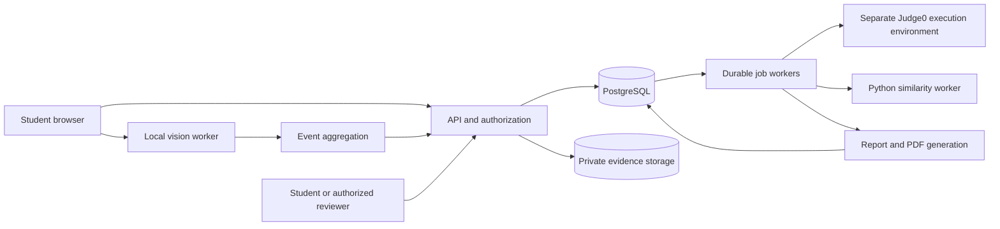

# Phase 0: Architecture and evidence design

Status: proposed implementation baseline. All timing, retention and detection settings below are our initial engineering choices, not vendor rules or calibrated scientific thresholds.

## Deployment and technology decisions

Use a modular backend rather than many independently deployed services initially.

| Module | Proposed choice | Responsibility |
|---|---|---|
| Student/reviewer web app | React, TypeScript, Monaco | Assessment and review UI |
| Camera worker | MediaPipe, with separate gaze/object adapters | Local frame inference without blocking editing |
| API | Node.js, TypeScript, Express | Authentication, authorization, attempts, drafts, events and results |
| Database | PostgreSQL | Durable attempt state and job queue initially |
| Execution worker | Judge0 API adapter | Isolated compilation/execution and result mapping |
| Similarity worker | Python tokenization and fingerprint matching | Versioned comparisons and source spans |
| Evidence store | Private S3-compatible object storage | Snapshots, exports and expiry |
| Reports | HTML templates and server-side PDF rendering | Deterministic narrative, no LLM required |

Start with Python as the student submission language; add C++ and Java through the same runner and tokenizer interfaces. Pin dependencies and model artifacts when implementation starts. Hosted runner credentials and hidden tests stay server-side. Hosting provider, budget and scale remain deployment decisions; local development can proceed first.



## Attempt and execution lifecycle

Attempt states: created → preflight → active → submitted/expired → analysing → completed. Analysis errors are separately tracked and retryable; a failed similarity job must not erase coding results. An abandoned attempt is explicit.

- Server owns start/deadline, allowed languages, problem versions and scoring policy. Refresh never resets time.
- Autosave draft revisions with optimistic concurrency. Display last server acknowledgement; retain a local draft for recovery without promising recovery after local storage loss.
- Final submission uses an idempotency key and freezes an immutable code revision. Repeat clicks cannot create different final results.
- At expiry, grade the latest server-acknowledged draft, with a clear indication if newer local changes never reached the server. Do not accept a client-edited timestamp as proof of pre-deadline submission.
- Run uses public tests; submit uses server-held hidden tests. Store results with code hash, problem version, runner configuration and test-set version.
- Worker jobs use leases, retry limits and idempotent outputs. The runner has CPU, wall-time, memory, process and output limits, restricted network access and no access to application secrets or database.
- A runner/provider failure yields execution unavailable, not wrong answer. Provider choice and limits require a smoke test before Phase 1 closes.

## Storage model

Principal entities: users, assessments, problem_versions, assessment_rules, attempts, consent_records, draft_revisions, submissions, execution_results, monitoring_intervals, events, evidence_objects, similarity_findings, review_decisions, report_versions and jobs.

Every attempt snapshots its rules. Every finding records detector/configuration versions. Evidence belongs to an attempt and uploader; access checks apply to both metadata and object downloads. Student access to other students' code is disabled by default; cross-student comparison details are reviewer-only or suitably redacted.

Initial API contracts:

- `POST /attempts`, `POST /attempts/:id/start`: create and start after preflight.
- `PUT /attempts/:id/draft`: code, language and expected revision.
- `POST /attempts/:id/runs`, `POST /attempts/:id/submit`: asynchronous run or immutable final submission.
- `POST /attempts/:id/events/batch`: bounded, validated event batch with deduplication acknowledgements.
- `POST /attempts/:id/evidence`: authorized upload allocation; size/type limits and checks on completion.
- `GET /attempts/:id/report`: coding, per-detector coverage, findings and job statuses.
- `POST /findings/:id/reviews`: authorized decision with reason and audit record.
- `DELETE /attempts/:id/evidence`: deletion request and status.

## Observation-to-finding pipeline

Raw observation → quality gate → duration aggregation → versioned review rule → finding → optional human decision.

Do not store every frame or face mesh by default. Initial performance target: sample vision at 5 frames/second, adapting downward on slow hardware while exposing actual coverage. Never infer continuous observation across a processing gap.

An event record contains:

```json
{
  "schema_version": 1,
  "event_id": "uuid",
  "attempt_id": "uuid",
  "client_session_id": "uuid-per-page-load",
  "sequence": 42,
  "type": "head_orientation_deviation",
  "source": "head_pose",
  "start_elapsed_ms": 120000,
  "end_elapsed_ms": 124000,
  "client_wall_time": "ISO-8601",
  "detector_version": "model-and-code-version",
  "configuration_version": "policy-version",
  "quality": {"status": "usable", "reason": null},
  "measurements": {"direction": "down", "duration_ms": 4000},
  "evidence_ids": [],
  "end_reason": "returned_to_baseline"
}
```

Server adds receipt time and validates ownership, duration bounds, payload size and known event types. Use monotonic time within a page session, with a server start-time anchor and fresh anchor after reload. Preserve wall-time/receipt-time discrepancies; client timestamps and camera observations are untrusted telemetry, not tamper-proof evidence.

Batch every 2 seconds when online; persist a bounded local queue and retry by event ID. Track queue overflow as data loss. On reload, resume upload without duplication. Heartbeat every 5 seconds; a 15-second absence creates provisional coverage unknown, reconciled with late data. Background throttling or inference stalls must not become face-absence events.

Coverage is per detector: usable observation time divided by eligible assessment time, with valid, invalid, missing and disabled intervals. Merge overlapping intervals rather than summing durations. Event count alone does not measure coverage.

## Initial detector rules for experiments

These are tuning seeds only; held-out evaluation determines release settings.

| Detector | Initial aggregation | Output and limitation |
|---|---|---|
| Browser visibility/focus | Record state transitions immediately; preserve separate types | Cannot identify another tab's contents or destination app |
| Face not detected | Aggregate 3 seconds of processed frames without a detection | Does not distinguish absence from difficult lighting; stopped processing is a gap |
| Multiple faces | At least two detections sustained for 1 second | No identity claim; test posters and images as negative cases |
| Head pose | Relative yaw >25° or pitch >20° for 3 seconds; return band 5° smaller | Experimental baseline-relative orientation, not gaze or phone use |
| Gaze deviation | Outside calibrated screen region plus error margin for 3 seconds; repeat count ≥3 within 60 seconds | Suppress review flags when calibration/quality fails; exact estimator and margin pending experiment |
| Phone visible | Repeated object detections across ≥1 second; score threshold set from evaluation | Phone class and location only; not proof of use or AI assistance |
| Similarity | Minimum matching span and coverage threshold selected by problem-specific evaluation | No universal plagiarism percentage; exclude provided scaffolding |

Use hysteresis to avoid flickering events. End an event on return, monitoring interruption or attempt end; record the reason. Overlapping visibility/focus events may share a timeline group but must not count as independent corroboration. Likewise gaze and head pose are related signals, not independent evidence of misconduct.

## Capture and retention proposal

- Default practice mode: local camera processing and metadata upload; no images, video or microphone audio retained.
- Evidence-enabled mode: separate consent before starting; webcam snapshots at event onset and every 5 seconds while the event persists, rate limited to one image per second globally. Capture success/failure is explicit.
- Optional screen mode: user-selected display stream; periodic screenshot every 15 seconds and on relevant browser events, with global rate limits. Record selected surface type when available and stopped-share events. Never claim an unshared display was observed.
- No continuous recording by default. A snapshot timeline is not continuous video replay. Future video recording requires a separate storage and consent design.
- Proposed expiry: evidence images and derived PDFs after 7 days; attempt metadata, code and report data after 90 days. Offer immediate user deletion; revoke access immediately and delete active objects within 24 hours. Backup expiry must be specified before hosting real users, with deletion reapplied on restore.
- TLS, private buckets, short-lived download links, authorized reviewer access and access auditing. No raw media in application logs. No training on student evidence by default.
- Low quality or permission loss means unavailable/insufficient coverage, never an automatic misconduct decision. Report two independent dimensions: monitoring completeness and findings requiring review.

## Similarity and report design

Compare same-problem, same-language submissions first. Tokenize with source offsets, remove comments/formatting and supplied scaffolding, normalize identifiers, fingerprint token spans, then verify matches against originals. Store coverage denominator, minimum span, comparison set, corpus version and matching source lines. Short standard solutions need separate calibration. Structural comparison is a later extension within Phase 5 if token methods miss required transformations.

Report sections: coding score; execution status; monitoring coverage by detector; timestamped findings; evidence availability; similarity matching regions; reviewer conclusions; limitations. Empty comparison set means not evaluated, not zero similarity. Expired evidence stays visibly expired. PDF escapes all candidate content and uses the same versioned report data as the UI.

No combined probability of cheating. A detector confidence score is not the probability of misconduct. A reviewer decision includes the applicable rule and a reason; retain the original observation separately.
